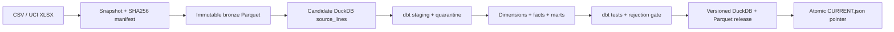

# Retail Analytics Warehouse

A complete **local-first data engineering learning project**: preserve source evidence, build a tested dimensional warehouse, replay late data, and recover from a failed publication. No paid services, Docker, Airflow, or cloud account required.

**Stack:** Python 3.11+, DuckDB, Parquet, dbt-duckdb, pytest. Linux/macOS supported. DuckDB uses two threads with a 1 GB build memory limit and a 512 MB ingestion limit, leaving headroom on an 8 GB Mac. Those limits are database settings, not a cap on total Python/dbt process memory.

## Run it in five minutes

From the repository root:

```bash
python3 -m venv .venv
source .venv/bin/activate
python -m pip install -r requirements.lock
python -m pip install --no-deps -e .
make demo
```

`requirements.lock` pins the dependency versions. To intentionally upgrade them, regenerate with `uv pip compile pyproject.toml --extra dev --universal --output-file requirements.lock` and rerun verification.

`make demo` creates deterministic fixtures, ingests and publishes the initial batch, adds an older late-arriving invoice, and publishes again. Expected results:

| Stage | Source rows | Fact rows | Quarantined | Net sales |
|---|---:|---:|---:|---:|
| Initial fixture | 17 | 13 | 4 | 33.99 |
| After late arrival | 18 | 14 | 4 | 43.97 |

The data is synthetic. Currency is a single assumed GBP reporting currency; country is not a currency indicator. Net sales exclude tax, shipping, and any fields not supplied by the source.

```bash
retail status
retail verify
retail query "SELECT * FROM mart_daily_sales ORDER BY date_key, country"
make verify
```

`retail --root /path/to/warehouse ...` isolates another dataset. The global `--root` option goes **before** the subcommand; `fixture --output` is independent of it.

## What is implemented

- **Immutable raw evidence:** snapshot original CSV/XLSX bytes, SHA-256 source hash, typed bronze Parquet, Parquet hash, ingestion timestamp, provenance, counts and event-time range. Exact file reingestion is idempotent.
- **Stable physical row identities:** SHA-256 of file content hash, worksheet and physical row number. Identical repeated lines in one invoice remain separate. Overlapping different export files are **not** business-deduplicated.
- **Explicit cleaning rules:** cancellation prefixes and negative quantities become signed returns; negative/non-finite prices, invalid dates/quantities, missing invoice/product codes go to quarantine. Missing customers become `UNKNOWN`. Supported source-local timestamps are in `[1900-01-01, 9999-12-31)` to match dimension validity; dates outside that range are quarantined. Prices use Decimal(18,4), money uses Decimal(18,2) with half-up rounding per line. Free samples are retained.
- **Star schema:** date, product, customer and invoice-line fact models; daily sales and lifetime customer-value marts; retained lineage back to raw rows. Product dimension is Type 1.
- **SCD Type 2 teaching example:** deterministic, synthetic history changes customer `101` from standard to loyal on 2024-02-01. Facts join using half-open validity intervals. This is not real CRM history inferred from UCI data.
- **Incremental ingestion:** track loaded manifests and event-time watermark, replay a configurable lookback, and always include unseen files even when their event timestamps are old. Explicit backfill replays complete overlapping files. All dbt models rebuild each time for correctness and simplicity.
- **Reliable runs:** unique run/attempt IDs, a single-writer OS lock, bounded retries for filesystem errors and dbt timeouts, per-run JSON status and dbt logs, configurable rejection threshold.
- **Atomic publication:** all dbt tests must pass before the DuckDB database and Parquet tables are exposed together through `CURRENT.json`. Failed candidates stay available for diagnosis. Old published releases remain immutable.
- **Recovery:** checksum verification before reuse (including the copied database), rollback to a previously successful release, deliberate failure drills, and replay after a failed run.
- **CI:** lint and real pytest/dbt integration tests on Python 3.11 and 3.12.

## Architecture



```text
data/
  raw/<sha256>/             # original bytes, bronze.parquet, manifest.json
  runs/<run-id>/            # run.json; failed attempt directories + logs
  releases/<release-id>/   # SUCCESS.json, warehouse.duckdb, parquet/, dbt/
  CURRENT.json             # reader-visible pointer, replaced atomically
  rollbacks/               # rollback audit events
```

A reader must resolve `CURRENT.json` **once** per analysis, then use that release's DuckDB file (read-only) or Parquet directory. Do not query all release directories at once: every release is a complete dataset, not a delta.

## Optional: UCI Online Retail

The fixture path needs no network. For a larger real dataset, download **Online Retail.xlsx** from the [official UCI dataset page](https://archive.ics.uci.edu/dataset/352/online+retail), unzip if needed, and run it in a separate root:

```bash
retail --root data/uci ingest /path/to/Online\ Retail.xlsx \
  --provenance 'UCI Online Retail; Daqing Chen; DOI 10.24432/C5BW33; CC BY 4.0'
retail --root data/uci run
retail --root data/uci query "SELECT sum(net_sales) FROM mart_daily_sales"
```

Dataset credit: Chen, D. (2015). *Online Retail*. UCI Machine Learning Repository. [DOI: 10.24432/C5BW33](https://doi.org/10.24432/C5BW33). The dataset's CC BY 4.0 terms are separate from this repository's MIT software license. Data is not redistributed here. Never treat the synthetic customer history as an attribute supplied by UCI.

The XLSX reader is streaming (`openpyxl` read-only), with batched loading. The full UCI file has not been benchmarked as part of the synthetic test suite. Real data can contain unsupported timestamps or unusually precise prices, which will be visible in quarantine; inspect those records rather than blindly raising the rejection threshold.

## Replay, backfill, and incident practice

```bash
# Idempotent replay; all unseen raw files also load, regardless of age.
retail run --lookback-days 7

# Replay every complete file overlapping [Jan 1, Feb 1).
retail run --from 2024-01-01 --to 2024-02-01

# Rebuild from every available raw manifest.
retail run --full-refresh

# These deliberately exit nonzero. CURRENT.json must remain unchanged.
retail run --fail-stage after-load
retail run --fail-stage before-publish

# Find a prior ID in data/releases/, then verify and switch publication.
retail rollback RELEASE_ID
retail verify
```

The default 30% reject threshold accommodates the deliberately bad fixture (4/17). Choose a stricter value for a real contract, e.g. `retail run --max-reject-rate 0.01`. It measures the whole candidate dataset, not just the newly arriving batch. dbt relationship, uniqueness, non-null, reconciliation, SCD interval and sign tests are always required.

## Learn the project

1. [Learning guide](docs/learning-guide.md): trace one row, explain each decision, then try exercises.
2. [Architecture and contracts](docs/architecture.md): grains, identities, incremental behavior and trade-offs.
3. [Operations runbook](docs/runbook.md): inspect runs, replay late records and recover safely.
4. Read `src/retail_warehouse/ingest.py`, then the dbt SQL, then `pipeline.py`.
5. Run `pytest -q`. Integration tests execute real dbt builds rather than substituting mock SQL.

## Deliberate limitations

This is a bounded single-machine warehouse, not a distributed production platform. It uses `fcntl` (macOS/Linux), one writer, a local filesystem, full mart rebuilds and retained full snapshots. Disk grows with releases; review and remove obsolete artifacts manually only after backing up evidence. Atomic rename protects readers from partial publication on normal local filesystems; host power-loss durability, network-filesystem semantics and disaster recovery are not claimed. The SCD2 example is fixed synthetic history, not a generic mutable CDC engine. No timezone, currency conversion, order-level matching of refunds, customer PII, customer deletion workflow, or automatic correction of changed source exports is inferred. Backfill operates at file granularity; source duplicates across changed/overlapping files require an upstream business key or reconciliation policy.
